<!-- BANNER SLOT: put your anime art at assets/banner.png (1280x400) -->

# Karan Satyawali
### Cybersecurity Engineer · Detection Engineering · AI-Powered Security Systems

<!-- DIVIDER SLOT (optional): assets/divider.png (1280x120) -->

## 🎯 Focus Areas
- SOC automation and threat hunting
- Detection engineering and alert tuning
- AI-assisted security tooling

## 🛠 Tech Stack

